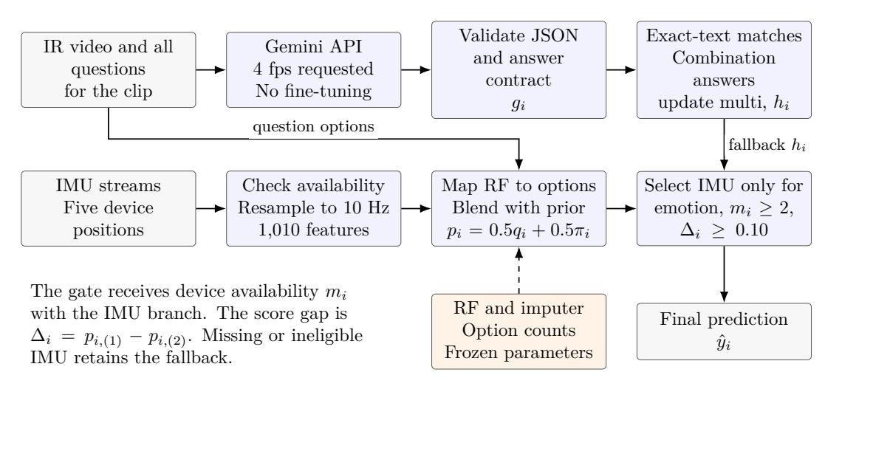

# Saw It: CUHK-X Large Model Track

Infrared video question answering with Gemini, IMU-based emotion classification, and consistency across questions.

Hanif Noer Rofiq · Team Saw It · CUHK-X Challenge 2026

[Paper](paper/Saw_It_CUHKX_Solution_Paper.pdf)

## Method



We use Gemini to answer the questions associated with each infrared video. For emotion questions, we train a 400-tree Random Forest on 1,010 features from five IMU positions. We average its option probabilities with a prior estimated from the training data and replace the video answer when at least two devices are usable and the score margin is at least 0.10.

An exact-text consistency rule connects combination and multiple-answer questions about the same clip. Actions in the predicted combination are added to matching multiple-answer options.

## Results

| Evaluation | Result |
|---|---:|
| Local development, subject holdout | 768/972 (79.01%) |
| Kaggle public leaderboard | 0.78654 |
| Kaggle private leaderboard | 0.81176 |

## Setup

Python 3.13.9 and Bash. The local model runs on CPU; video inference requires Gemini API access.

```bash
git clone https://github.com/hanifnoerr/cuhk-x-saw-it.git
cd cuhk-x-saw-it
python3 -m venv .venv
source .venv/bin/activate
python3 -m pip install -r requirements.txt
```

## Training

Use the official `training_qa.csv` and `LMT_(IMU,Radar,Skeleton).zip`:

```bash
bash train.sh TRAINING_QA_CSV OFFICIAL_SENSOR_ZIP artifacts
```

The script reads the fixed settings from `configs/sensor_config.json` and saves the model and supporting files to `artifacts/`.

## Inference

After training, supply your Gemini API key and the official nonvisual archive:

```bash
read -rsp 'Gemini API key: ' GEMINI_API_KEY
printf '\n'
export GEMINI_API_KEY
export CUHKX_SENSOR_PATH="PATH_TO_NONVISUAL_ARCHIVE"
bash inference.sh DATA_DIR predictions.csv
```

Use the official Testing directory for `DATA_DIR`. It should contain `test_qa.csv` and the IR videos, either extracted or in `large_model_track_test.zip`. The output CSV contains `qa_id,prediction`.
